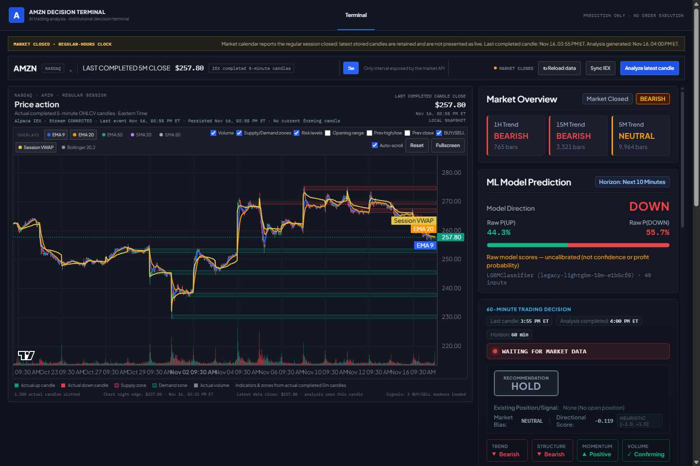
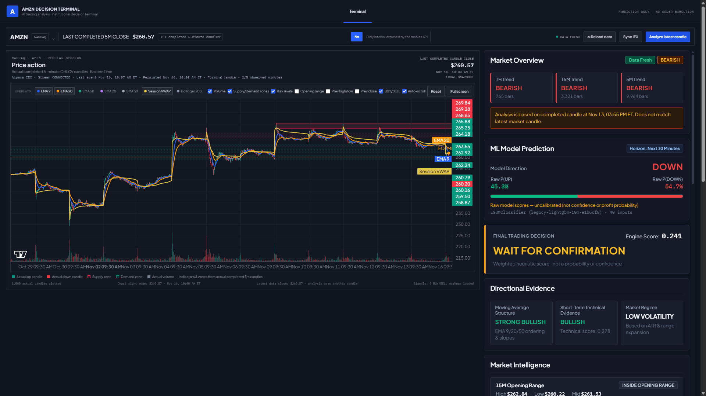
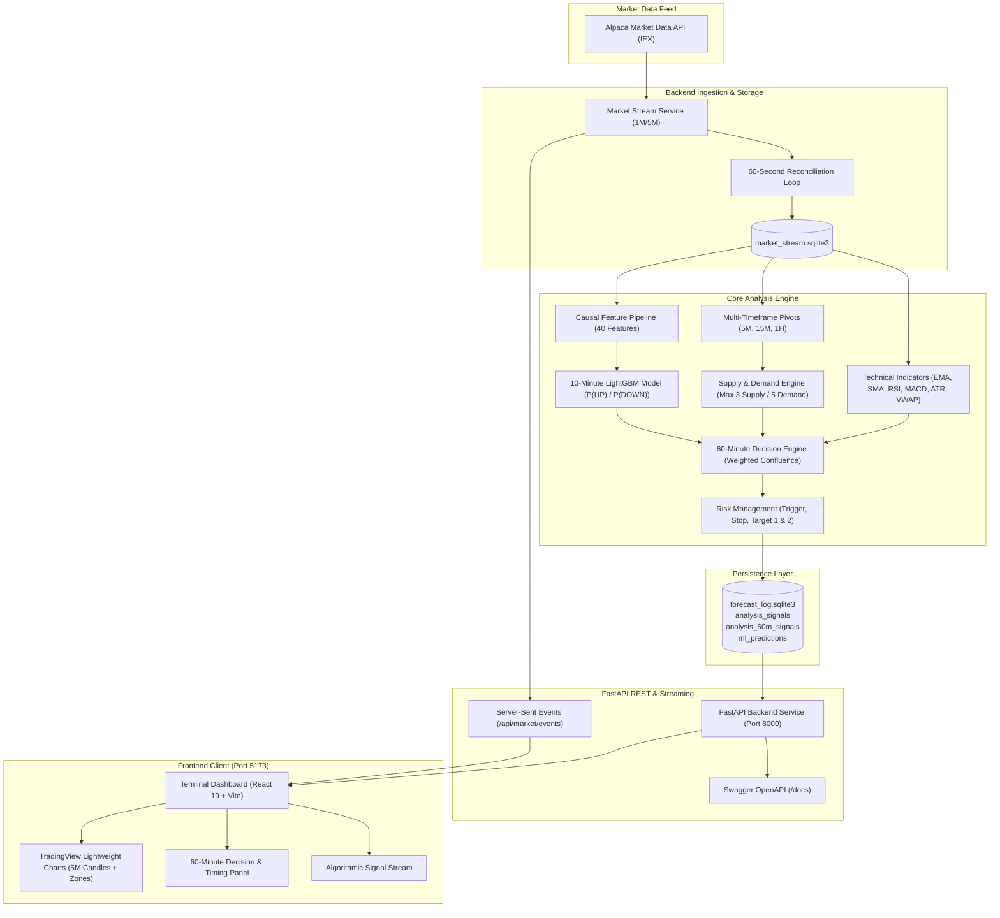

# AMZN AI Trading Decision Terminal

[](https://www.python.org/)
[](https://fastapi.tiangolo.com/)
[](https://react.dev/)
[](https://lightgbm.readthedocs.io/)
[](https://alpaca.markets/)
[](tests/)

An institutional-grade, real-time market analysis and algorithmic trading decision-support terminal built specifically for Amazon.com, Inc. (`NASDAQ: AMZN`). The platform integrates machine learning, multi-timeframe market structure, support/resistance supply and demand zones, technical analysis, and a specialized 60-Minute Trading Decision Engine.

> **IMPORTANT DISCLAIMER**
> This terminal is an academic and algorithmic research tool developed for **decision-support and market simulation only**. It generates hypothetical signals, risk plans, and paper-trade logs. It **does NOT execute live broker orders** and is not financial advice.

---

## Table of Contents

- [Overview](#overview)
- [Key Features](#key-features)
- [Visual Interface & Screenshots](#visual-interface--screenshots)
- [System Architecture](#system-architecture)
- [Machine Learning & Decision Methodology](#machine-learning--decision-methodology)
  - [10-Minute LightGBM Model](#1-10-minute-lightgbm-model-micro-momentum)
  - [60-Minute Trading Decision Engine](#2-60-minute-trading-decision-engine)
- [Supply and Demand Zone Methodology](#supply-and-demand-zone-methodology)
- [Risk Management & Signal Lifecycle](#risk-management--signal-lifecycle)
- [Installation & Setup](#installation--setup)
- [Environment Variables](#environment-variables)
- [How to Run the Application](#how-to-run-the-application)
- [Application URLs](#application-urls)
- [Troubleshooting](#troubleshooting)
- [Testing & Verification](#testing--verification)
- [Project Limitations & Disclaimer](#project-limitations--disclaimer)
- [Future Roadmap](#future-roadmap)
- [License & Contributing](#license--contributing)

---

## Overview

Intraday algorithmic trading requires understanding both short-term micro-momentum and multi-timeframe structural barriers. Rather than relying on simple moving-average crossovers or opaque "black-box" models, the **AMZN AI Trading Decision Terminal** synthesizes:

1. **Micro-Momentum Machine Learning**: A trained 40-feature LightGBM model evaluating the direction of the next 10-minute candle.
2. **Multi-Timeframe Structure**: 5M, 15M, and 1H structural pivots identifying major institutional levels.
3. **Refined Supply & Demand Zones**: Automatically detecting finite overhead supply and underfoot demand, bounded by a maximum of the 3 most significant resistance zones and up to 5 support zones.
4. **60-Minute Decision Confluence**: A systematic heuristic engine evaluating Trend, Structure, Momentum, Volume, and Session VWAP to deliver actionable `BUY`, `SELL`, `HOLD`, or `WAIT FOR CONFIRMATION` recommendations.

---

## Key Features

- **Live Market Ingestion**: Ingests AMZN regular trading hours (09:30–16:00 ET) 1-minute and 5-minute OHLCV candles via the Alpaca IEX data feed.
- **Real-Time Candle Reconciliation**: Automated background reconciliation loop identifies missing intervals, backfills historical bars, and prevents gaps.
- **Interactive Candlestick Chart**: Powered by TradingView Lightweight Charts v5 with custom HTML5 Canvas rendering for finite rectangular supply/demand boxes.
- **10-Minute Directional Classifier**: Production LightGBM model (`artifacts/model_lightgbm.joblib`) processing 40 causal technical and temporal features.
- **Dedicated 60-Minute Decision System**: Evaluates market conditions over an actionable 1-hour horizon (12 consecutive 5-minute candles).
- **Four Clear Action Recommendations**:
  - `BUY`: Strong bullish confluence, confirmed structure, clear overhead runway, valid R:R $\ge 1.5$.
  - `SELL`: Strong bearish confluence, confirmed structure, clear support runway, valid R:R $\ge 1.5$.
  - `WAIT FOR CONFIRMATION`: Directional score is strong but execution is blocked by zone proximity or unconfirmed multi-timeframe alignment.
  - `HOLD`: Neutral, rangebound, session-close, or opening discovery conditions.
- **Multi-Timeframe Alignment**: Simultaneous analysis across 5M tactical bars, 15M intermediate swings, and 1H macro market structure.
- **Comprehensive Indicator Suite**: Causal implementations of EMA (9/20/50), SMA (20/50), RSI (14/7), MACD (12, 26, 9), ATR (14), Bollinger Bands, and Session VWAP.
- **3 Major Supply Zones**: Dynamically selects and renders strictly the 3 strongest valid overhead resistance zones, preventing chart clutter.
- **Up to 5 Demand Zones**: Preserves up to 5 multi-session support zones distributed across visible price history.
- **Independent Zone Retest Counting**: State-machine departure filter (`separation_buf = max(0.20, 0.40 * atr)`) counts genuine independent tests rather than inflating touches during consolidation.
- **Multi-Factor Zone Quality Scoring**: Rates levels from 0 to 100 based on timeframe confirmation, multi-session defense, retests, and structural validity.
- **Dual-Distance Tooltip**: Inspects hovered zones showing distance from current market price (`Dist (Current)`) alongside distance from hovered historical bars (`Dist (This Bar)`).
- **Algorithmic Risk Management**: Automates calculation of Trigger Price, Stop-Loss, Target 1 (1.0 R), Target 2 (2.0 R), and Reward-to-Risk ratio.
- **Dual Signal Stream**: Tracks both high-frequency 10-minute ML predictions and 60-minute structural trading decisions in separate audit panels.
- **Simulated Trade Outcome Engine**: Evaluates theoretical trade resolutions (`TARGET_1`, `TARGET_2`, `STOP_LOSS`, `EXPIRED`) with transaction friction (10 bps round-trip).
- **Dynamic Next Prediction Time**: Displays dynamically formatted next-prediction targets in Eastern Time (`America/New_York`) with session curfew awareness.
- **Persistent SQLite Architecture**: Local zero-dependency persistence across `forecast_log.sqlite3`, `market_stream.sqlite3`, and `paper_trading.sqlite3`.
- **FastAPI OpenAPI Documentation**: Interactive Swagger UI (`/docs`) and ReDoc (`/redoc`) for all REST endpoints.

---

## Visual Interface & Screenshots

### 1. Main Trading Dashboard
The terminal surfaces a real-time market overview, current 60-minute decision card with dynamic next-prediction countdown, 10-minute micro-momentum prediction, and the 1,500-candle plotted TradingView chart:



### 2. Multi-Timeframe Candlestick Chart & Supply/Demand Zones
Finite rectangular zones highlight institutional resistance (red) and demand (green) with overlaid EMA lines, Session VWAP, and algorithmic trade setup markers:



---

## System Architecture



For full architectural documentation, see [docs/ARCHITECTURE.md](docs/ARCHITECTURE.md).

---

## Machine Learning & Decision Methodology

### 1. 10-Minute LightGBM Model (Micro-Momentum)
- **Model Type**: Frozen LightGBM binary classifier (`artifacts/model_lightgbm.joblib`).
- **Input Dimension**: Exactly 40 ordered numerical features (`artifacts/feature_columns.json`).
- **Prediction Horizon**: 10 minutes (the directional change over the subsequent two 5-minute bars).
- **Features Included**:
  - Return dynamics: 1-bar, 2-bar, 3-bar percentage returns, log return, dollar price change.
  - Candle anatomy: Body size, range, upper wick, lower wick, body-to-range ratio.
  - Moving averages: SMA (5, 10, 20) and EMA (5, 10, 20).
  - Momentum: MACD line, signal, histogram, RSI 14, ROC 5, ROC 10.
  - Volatility: ATR 14, Bollinger Upper, Middle, Lower, Width, and %B position.
  - Volume profiling: Volume change, SMA 5, SMA 20, volume ratios, distance to VWAP.
  - Temporal cyclical encoding: Hour, minute, day of week, sine/cosine time-of-day.
- **Uncalibrated Probability Output**:
  - The model outputs raw probabilities $P(\text{UP})$ and $P(\text{DOWN}) = 1 - P(\text{UP})$.
  - **Important**: These scores are uncalibrated raw model outputs. They do not represent Bayesian probabilities or guaranteed win rates.
  - Role: Acts as **micro-momentum context** within the broader decision engine.

### 2. 60-Minute Trading Decision Engine
The 60-minute engine answers whether a trader entering the market should buy, sell, or hold for the coming one-hour window (12 x 5-minute bars).

#### Evidence Weighting Confluence
The engine computes a directional composite score $S \in [-1.0, +1.0]$ across five weighted categories:

| Category | Weight | Indicators & Confluence Signals Evaluated |
|---|:---:|---|
| **Trend Alignment** | 25% | EMA 9/20/50 slopes, SMA 20/50 alignment, and 15M/1H higher-timeframe trend consistency. |
| **Market Structure** | 25% | Position relative to 3 major supply zones and 5 demand zones, Break of Structure (BOS), and prior session levels. |
| **Momentum** | 20% | RSI 14 and RSI 7 thresholds, MACD histogram momentum and acceleration, ROC 5/20. |
| **Volume Confirmation** | 10% | Session volume vs 20 SMA, intraday Relative Volume (RVOL), breakout volume confirmation. |
| **VWAP & Price Action** | 20% | Price position relative to Session VWAP, candle body-to-range ratios, and upper/lower rejection wicks. |

#### Decision State Mapping
- **`BUY`**: $S \ge +0.35$ (or $\ge +0.60$ for Strong Buy), price above VWAP, clear overhead resistance runway ($\ge 0.35\text{ ATR}$), valid risk parameters.
- **`SELL`**: $S \le -0.35$ (or $\le -0.60$ for Strong Sell), price below VWAP, clear underfoot support runway ($\ge 0.35\text{ ATR}$), valid risk parameters.
- **`WAIT FOR CONFIRMATION`**: $|S| \ge 0.35$, but constrained by zone proximity ($< 0.35\text{ ATR}$ to opposing barrier), lack of MTF confirmation, or unfavorable R:R.
- **`HOLD`**: $|S| < 0.35$ (balanced or choppy market), Opening Discovery Curfew (09:30–09:45 ET), or Closing Curfew (15:15–16:00 ET).

For comprehensive mathematical and feature specifications, see [docs/MODEL_METHODOLOGY.md](docs/MODEL_METHODOLOGY.md).

---

## Supply and Demand Zone Methodology

Supply and demand zones represent institutional liquidity pools where price previously demonstrated aggressive buying or selling rejection.

```
       Supply Zone (Resistance) Ceiling = High of Swing Wick
  ┌─────────────────────────────────────────────────────────────┐
  │                                                             │
  └─────────────────────────────────────────────────────────────┘
       Supply Zone Floor = max(Open, Close) of Swing Body

       ~ ~ ~ ~ ~ Price Action & Retests ~ ~ ~ ~ ~

       Demand Zone Ceiling = min(Open, Close) of Swing Body
  ┌─────────────────────────────────────────────────────────────┐
  │                                                             │
  └─────────────────────────────────────────────────────────────┘
       Demand Zone (Support) Floor = Low of Swing Wick
```

1. **Multi-Timeframe Pivot Anchoring**:
   - Detects confirmed swing highs and lows across 5M, 15M, and 1H timeframes.
   - Anchored via the TradingView Wick-and-Body standard:
     - **Supply**: Upper boundary is the swing high wick; lower boundary is the real body top ($\max(\text{open}, \text{close})$).
     - **Demand**: Lower boundary is the swing low wick; upper boundary is the real body bottom ($\min(\text{open}, \text{close})$).
2. **Independent Retest State Machine**:
   - To prevent touch-count inflation (e.g. 99 consecutive candles inside a consolidation zone), the engine enforces an ATR separation rule:
     $$\text{separation\_buffer} = \max(0.20, 0.40 \times \text{ATR})$$
   - Price must leave the zone by at least $0.40\text{ ATR}$ before returning to count as an independent retest.
   - Distinct trading sessions increment touch counts independently.
3. **Display Rules (Maximum 3 Supply / 5 Demand)**:
   - **Supply Zones (Max 3)**: Ranked by timeframe (1H preferred), quality score, independent retests, multi-session defense, and recency. Strictly caps overhead resistance to the 3 major institutional levels.
   - **Demand Zones (Max 5)**: Retains up to 5 multi-session support zones distributed across the price scale.
4. **Historical Invalidation**:
   - A supply zone is invalidated when a candle closes above $\text{Upper} + 0.25\text{ ATR}$.
   - A demand zone is invalidated when a candle closes below $\text{Lower} - 0.25\text{ ATR}$.
   - Invalidated zones truncate at their breaking bar; they do not extend into future price action.

---

## Risk Management & Signal Lifecycle

When a `BUY` or `SELL` setup is approved, the terminal computes an automated risk execution plan:

- **Trigger Price**: Closing price of the evaluation candle.
- **Stop-Loss**: Placed beyond the invalidation structure buffered by $0.25\text{ ATR}$:
  - Long: $\text{Stop} = \min(\text{Structure Low}, \text{Trigger} - 1.2\times\text{ATR})$
  - Short: $\text{Stop} = \max(\text{Structure High}, \text{Trigger} + 1.2\times\text{ATR})$
- **Target 1 ($1.0\text{ R}$)**: Partial profit objective at $1.0\times$ the initial dollar risk.
- **Target 2 ($2.0\text{ R}$)**: Macro objective at $2.0\times$ the initial dollar risk (subject to a minimum Reward-to-Risk ratio of 1.5 against the nearest opposing zone).
- **Transaction Costs**: Models realistic execution friction by deducting **10 bps round-trip slippage and fees**.

### Signal States
```
[PENDING_TRIGGER] ──► [ACTIVE] ──┬──► [RESOLVED_TARGET_1] ──► [RESOLVED_TARGET_2]
                                 ├──► [RESOLVED_STOP_LOSS]
                                 ├──► [INVALIDATED] (Opposing structural breach)
                                 └──► [EXPIRED] (180 min maximum hold exceeded)
```

---

## Installation & Setup

### Prerequisites
- **Operating System**: Windows 10/11 (fully compatible with macOS and Linux).
- **Python**: Version 3.11, 3.12, or 3.14.
- **Node.js**: Version 18.x, 20.x, or 22.x with `npm`.
- **Git**: Installed and available in PATH.
- **Alpaca API Account**: Free Paper Trading API keys from [Alpaca Markets](https://alpaca.markets/).

### 1. Clone the Repository
Open Windows Command Prompt (`cmd.exe`) or PowerShell:

```cmd
git clone https://github.com/Ansh1084/amzn-trading-indicator.git
cd amzn-trading-indicator
```

### 2. Backend Environment Setup
From within the `amzn-trading-indicator` project folder:

```cmd
python -m venv .venv
call .venv\Scripts\activate.bat
python -m pip install --upgrade pip
pip install -r requirements.txt
```

### 3. Frontend Setup
```cmd
cd frontend
npm install
cd ..
```

---

## Environment Variables

Copy the provided `.env.example` file to create your local `.env`:

```cmd
copy .env.example .env
```

Open `.env` in any text editor and provide your Alpaca API credentials:

```env
# Alpaca Market Data Credentials (Free Tier uses 'iex')
ALPACA_API_KEY=your_alpaca_api_key_here
ALPACA_SECRET_KEY=your_alpaca_secret_key_here
ALPACA_FEED=iex

# Backend Service Configuration
BACKEND_HOST=127.0.0.1
BACKEND_PORT=8000

# Optional Frontend Override (defaults to http://127.0.0.1:8000/api)
# VITE_API_BASE_URL=http://127.0.0.1:8000/api
```

> [!WARNING]
> Never commit `.env` or expose your private Alpaca keys. The `.gitignore` file excludes `.env` and `.env.*`.

---

## How to Run the Application

To run the full stack on Windows, open **two separate Command Prompt (`cmd.exe`) windows**. Both must remain running.

### Terminal 1 — Backend (FastAPI Service)

From the `amzn-trading-indicator` directory:

```cmd
call .venv\Scripts\activate.bat
python -m uvicorn backend.app.main:app --host 127.0.0.1 --port 8000 --reload
```

*Expected output:*
```text
INFO:     Started server process [PID]
INFO:     Waiting for application startup.
INFO:     Application startup complete.
INFO:     Uvicorn running on http://127.0.0.1:8000 (Press CTRL+C to quit)
```

### Terminal 2 — Frontend (Vite Dev Server)

From the `amzn-trading-indicator` directory:

```cmd
cd frontend
npm run dev -- --host 127.0.0.1 --port 5173
```

*Expected output:*
```text
  VITE v6.0.0  ready in 250 ms

  ➜  Local:   http://localhost:5173/
  ➜  Network: http://127.0.0.1:5173/
```

Open your browser and navigate to **`http://localhost:5173`**.

---

## Application URLs

| Service | URL | Description |
|---|---|---|
| **Terminal Frontend** | [http://127.0.0.1:5173](http://127.0.0.1:5173) | Interactive trading chart, decision panels, and signal stream. |
| **Backend REST API** | [http://127.0.0.1:8000](http://127.0.0.1:8000) | Root service and health status (`/health`). |
| **Swagger UI Documentation** | [http://127.0.0.1:8000/docs](http://127.0.0.1:8000/docs) | Interactive OpenAPI documentation and endpoint testing. |
| **ReDoc API Documentation** | [http://127.0.0.1:8000/redoc](http://127.0.0.1:8000/redoc) | Alternative structured REST API documentation. |

---

## Troubleshooting

### 1. Port 8000 Already in Use
If another process is occupying port 8000:

```cmd
netstat -ano | findstr :8000
```
Note the Process ID (PID) displayed in the right-most column, then inspect the process:

```cmd
tasklist /FI "PID eq <PID>"
```
Terminate the process gracefully or specify an alternative port in your command:
```cmd
python -m uvicorn backend.app.main:app --host 127.0.0.1 --port 8001 --reload
```
*(If changing the backend port, create a `.env` in `frontend/` with `VITE_API_BASE_URL=http://127.0.0.1:8001/api`).*

### 2. Windows WinError 10013 (Access Denied)
Occurs when port 8000 is blocked by Windows Firewall or reserved by the Windows Internet Connection Sharing (ICS) service. Try binding to port `8080` or `5000`.

### 3. Virtual Environment Activation Blocked
If PowerShell rejects `.venv\Scripts\Activate.ps1` with an execution policy error:
```powershell
Set-ExecutionPolicy -ExecutionPolicy RemoteSigned -Scope CurrentUser
```
Or simply use standard Windows Command Prompt (`cmd.exe`) and execute:
```cmd
call .venv\Scripts\activate.bat
```

### 4. Market Closed / Stale Data Notice
- When the US equity market is closed (outside 09:30–16:00 ET weekdays), the terminal automatically displays a yellow status banner: `MARKET CLOSED — Regular-hours clock closed; showing latest stored completed candle`.
- The system continues to operate in replay mode using persisted SQLite candles and allows manual re-evaluation via **Analyze latest candle** or `POST /api/analysis/run`.

### 5. Frontend Cannot Connect to Backend
- Confirm Terminal 1 is running and shows `Uvicorn running on http://127.0.0.1:8000`.
- Open `http://127.0.0.1:8000/health` in your browser. It should return `{"status":"ok"}`.

---

## Testing & Verification

The repository includes a comprehensive automated test suite covering feature engineering, multi-timeframe pivots, zone lifecycle, decision gating, and legacy compatibility:

### Run Backend Unit & Integration Tests
From the `amzn-trading-indicator` directory with the virtual environment activated:

```cmd
python -m pytest -v
```

*Summary:* **325 passed, 1 skipped, 0 failed** in ~14 seconds.

Targeted test execution:
```cmd
# Test supply and demand zone detection, independent retests, and display capping
python -m pytest tests/test_supply_demand_zones.py -v

# Test 60-minute decision engine confluence and gating rules
python -m pytest tests/test_analysis_engine.py -v
```

### Run Frontend Production Build
```cmd
cd frontend
npm run build
```
*Summary:* TypeScript compilation (`tsc -b`) and Vite production bundle build succeed with 0 errors.

---

## Project Limitations & Disclaimer

1. **Research & Decision-Support Only**: This software is not an automated broker gateway. It does not interface with order-routing execution systems.
2. **Uncalibrated ML Probability Scores**: The LightGBM binary classifier outputs raw sigmoid scores. They reflect statistical feature associations over historical training folds, not true Bayesian certainty or future profit probability.
3. **Hypothetical Simulation**: Backtests and paper-trading outcome tracking incorporate standard assumptions (fixed 10 bps friction, 180-minute hold limits). Live execution may experience differing slippage, liquidity gaps, and commission structures.
4. **Market Data Constraints**: The Alpaca IEX data feed covers volume and quotes executed on the Investors Exchange. Quotes and volume may vary from consolidated SIP feeds during low-liquidity periods.

---

## Future Roadmap

- [ ] **Probability Calibration**: Implementation of Platt Scaling or Isotonic Regression on out-of-fold predictions to output empirical confidence intervals.
- [ ] **Dynamic Walk-Forward Evaluation**: Continuous rolling-window retraining with PurgedGroupTimeSeriesSplit.
- [ ] **Macro Volatility Regime Filter**: Incorporating VIX and market-wide SPY/QQQ beta correlation to scale position sizing dynamically.
- [ ] **Multi-Asset Architecture**: Generalizing the multi-timeframe zone and 60-minute engine to other high-liquidity US equities (e.g., AAPL, NVDA, MSFT).

---

## License & Contributing

### License
No license has been specified. All rights are reserved by the repository owner (`Ansh1084`).

### Contributing
1. Fork the repository.
2. Create a feature branch (`git checkout -b feature/improved-feature`).
3. Commit your changes with descriptive commit messages.
4. Verify all tests pass (`pytest` and `npm run build`).
5. Open a Pull Request for review.
