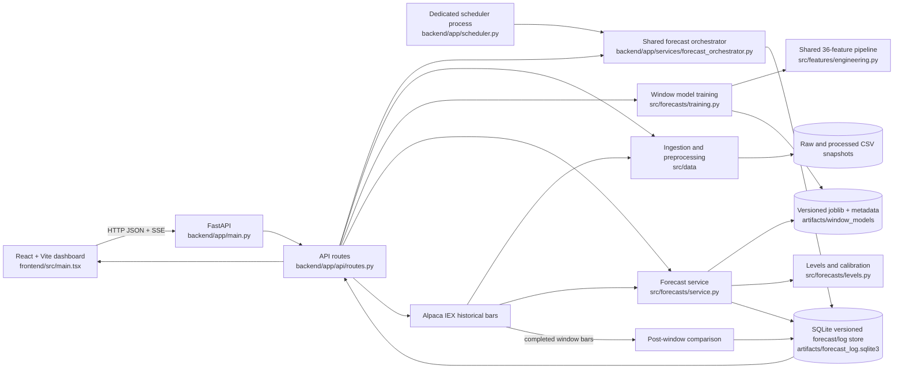

# AMZN Trading Indicator: Project Architecture

This document describes the inspected implementation in this repository. “Implemented” means source code exists and is connected to the current application path. “Partial” means code exists with stated limits. “Legacy/experimental” means it is not the model path used by the forecast API. The application is a forecasting and evaluation tool; it does not submit orders.

## System overview

The browser calls the FastAPI service; it does not access Alpaca credentials. The dashboard chart currently reads the newest local processed snapshot. Explicit refresh, forecast issuance, and actual comparison request Alpaca IEX data on the backend. Alpaca is queried through historical-bar calls; there is no persistent streaming/WebSocket connection.

## Repository map

| Path | Responsibility and when it runs |
|---|---|
| `backend/app/main.py` | Creates FastAPI, adds CORS for `localhost:5173` and `127.0.0.1:5173`, mounts the API router at `/api`, and exposes `/health`. Does not start the scheduler. |
| `backend/app/api/routes.py` | HTTP boundary, request validation, local/Alpaca candle selection, forecast/workflow APIs, scheduler health and SSE streams. |
| `backend/app/services/forecast_orchestrator.py` | Shared idempotent orchestration used by manual API triggers and scheduler for advance forecasts, afternoon updates, comparisons and retries. |
| `backend/app/services/workflow_operations.py` | Persistent workflow state, progress events, operation IDs, retry/recovery handling and SSE event history. |
| `backend/app/scheduler.py` | Dedicated standard-library scheduler process with persistent scheduled jobs, SQLite lease, bounded retry/backoff and New York time rules. |
| `frontend/src/main.tsx` | Single-page React application, on-demand API reads, EventSource progress, pages, chart, versioned forecast cards/history and scheduler view. No 15-second full-dashboard or forecast-issuance polling. |
| `frontend/src/style.css`, `frontend/src/status.css` | Dashboard layout and presentation. |
| `src/data/ingestion.py` | Alpaca IEX historical bars, local CSV loading, incremental snapshots, status summaries and CLI historical refresh. |
| `src/data/preprocessing.py` | Timestamp/OHLCV validation, RTH filtering, duplicate and gap reporting. No synthetic candles are filled. |
| `src/data/validation.py` | Reusable schema, timestamp and price consistency validation. |
| `src/features/engineering.py` | Causal feature calculations and the explicit `FEATURE_COLUMNS` model-input whitelist. |
| `src/targets/labeling.py` | Legacy 10-minute UP/DOWN target; not used by the final window model. |
| `src/data/splitting.py` | Chronological splitting helpers for the legacy experiment path. |
| `src/models/train.py`, `src/evaluation/metrics.py` | Legacy classifier training/evaluation, separate from final 3-hour model training. |
| `src/forecasts/calendar.py` | Previous trading day, scheduled holidays, session close and ET-to-UTC timestamps. |
| `src/forecasts/training.py` | Final per-evaluation-date and per-window training, walk-forward metrics, calibration, artifact metadata, hashes and loading. |
| `src/forecasts/service.py` | Pre-window issuance validation, inference, immutable forecast creation and post-window comparison. |
| `src/forecasts/levels.py` | Confirmed swing support/resistance, historical support-hold probability and conditional downside range. |
| `src/forecasts/store.py` | SQLite schema migration, online backup, additive versioned forecast storage and append-only log/actual operations. |
| `src/forecasts/operations.py` | Persistent status for background data refresh/model training. Uses a two-worker thread pool and process-local locks. |
| `configs/forecast_windows.json` | ET timezone, window schedule, lead time, support rules and calibration thresholds. |
| `data/raw/`, `data/processed/` | Local CSV snapshots; not application source and normally not tracked in Git. |
| `artifacts/window_models/` | Per-date trained window models and `metadata.json`; local artifacts. |
| `artifacts/forecast_log.sqlite3` | Versioned forecasts, separate post-window actuals, pipeline logs, workflow events/operations, scheduled jobs and scheduler lease. First migration creates a `.pre-v2-*.bak` online backup and retains the original tables. |
| `tests/` | Feature, target, preprocessing, training, forecast, operation and health tests. |

`src/inference/predict.py`, `src/evaluation/backtest.py`, and `src/models/registry.py` are not the live window-forecast route; inspect their current contents before presenting them as implemented services. The README mentions additional model experiments, but the connected final forecast path is the one in `src/forecasts/training.py`.

## Important request/response flows

### HTTP API

The frontend API base is `http://localhost:8000/api` in `frontend/src/main.tsx`. These are the inspected route methods and paths:

| Method and path | Parameters/body | Purpose and result |
|---|---|---|
| `GET /health` | — | `{"status":"ok"}` liveness response. |
| `GET /api/market/candles` | `limit` (1–10000; default 1200), `source=local|alpaca` | Candles plus source, row counts and timestamps. Dashboard uses `limit=2000&source=local`. |
| `GET /api/data/status` | `chart_limit` (default 2000) | Local dataset path, date span, counts and latest successful sync. |
| `POST /api/data/refresh` | — | HTTP 202; launches background incremental Alpaca refresh and returns operation status/id. |
| `GET /api/operations` | optional `kind` | Lists persistent refresh/training operation states. |
| `GET /api/operations/{operation_id}` | path ID | Reads one operation or 404. |
| `GET /api/config` | — | Returns configured windows and level/calibration settings. |
| `GET /api/forecasts` | optional `evaluation_date=YYYY-MM-DD` | Lists frozen forecast payloads, with `actual` null until comparison. |
| `GET /api/forecasts/{forecast_id}` | path ID | Returns one forecast and its separate actual payload. |
| `POST /api/forecasts/issue` | query `source` (default `alpaca`); JSON `{ "evaluation_date":"YYYY-MM-DD", "window_id":"morning" }` | Issues a forecast or returns a validation/data/model error. Successful issuance is HTTP 201. |
| `POST /api/forecasts/compare` | query `source` (default `alpaca`); JSON `{ "forecast_id":"..." }` | Compares after end and appends actual outcome. |
| `GET /api/pipeline-logs` | optional `forecast_id` | Returns structured log rows; filter to one forecast when needed. |
| `GET /api/model/status` | required `evaluation_date` | Metadata plus artifact verification and date eligibility. |
| `GET /api/model/versions` | optional evaluation date | Lists registered metadata summaries. |
| `POST /api/model/train` | required `evaluation_date` | HTTP 202; starts background training if preconditions pass. |
| `GET /api/model/{evaluation_date}` | date path | Returns registered model metadata or 404. |
| `POST /api/workflows/next-day` | JSON `{evaluation_date,retry_failed?}` | HTTP 202; refreshes data, verifies/trains the previous-close model as needed, then generates morning and afternoon ADVANCE records. |
| `POST /api/workflows/afternoon-update` | JSON `{evaluation_date,retry_failed?}` | HTTP 202; validates the complete morning window and generates the UPDATED afternoon record using the same registered model. |
| `POST /api/workflows/compare` | JSON `{evaluation_date,window_id?,retry_failed?}` | HTTP 202; compares completed eligible forecasts through the shared orchestrator. |
| `GET /api/workflows/{operation_id}` | path ID | Workflow state, progress, result/error and persisted events. |
| `POST /api/workflows/{operation_id}/retry` | path ID | Explicit safe retry of a failed workflow. |
| `GET /api/workflows/{operation_id}/events` | `Last-Event-ID` header supported | Per-operation SSE progress, heartbeat and terminal notification. |
| `GET /api/events?evaluation_date=...` | evaluation date; `Last-Event-ID` supported | SSE feed of manual and scheduled workflow events for a target date. |
| `GET /api/scheduler/status` | — | Scheduler enabled/running state, lease, next jobs, last success and failures. |

Route details are authoritative in `backend/app/api/routes.py`; the interactive OpenAPI schema is at `http://127.0.0.1:8000/docs` while the backend runs.

### Refresh data

`POST /api/data/refresh` starts `refresh_latest_market_data` in `src/data/ingestion.py` through `src/forecasts/operations.py`. The worker obtains completed 5-minute IEX bars, filters/validates them, merges and sorts unique timestamps, and writes new date-stamped raw and processed snapshots. Existing input snapshots are not overwritten. The frontend subscribes to operation events with SSE and falls back to status reads if the stream disconnects. Gaps are reported; missing candles are not fabricated. Incremental refresh starts after the last raw timestamp, so it is not a general repair for older holes. A no-new-bars result can be normal outside market hours.

### Train and register a model

`POST /api/model/train?evaluation_date=...` checks that the evaluation date is a scheduled trading day, no forecast has already been issued for it, no version is already registered, and the latest processed local candle is the expected last bar of the previous session. It launches `train_for_evaluation_date` in a worker. Training uses only rows through the prior session cutoff and writes window models plus metadata. The model-status route validates the files against SHA-256 hashes and checks cutoff and training time. A registered model is never silently replaced. Do not train on a demo day until the dataset is refreshed and the intended evaluation date is correct.

### Issue a forecast and persist it

The compatibility route `POST /api/forecasts/issue?source=alpaca` retains the earlier near-window behavior. The new application workflow uses `POST /api/workflows/next-day` and `POST /api/workflows/afternoon-update`; both flow through `forecast_orchestrator.py` and the existing `issue_window_forecast` inference service. The SQLite uniqueness key is now `(evaluation_date, window_id, forecast_type)`, so an afternoon ADVANCE and UPDATED can coexist while duplicate records of a given type are rejected.

For ADVANCE, the service caps inference inputs at the previous session’s last completed candle and only permits issuance after that close but before the target window. UPDATED is afternoon-only; it requires all 36 09:30–12:25 morning bars, a generation time after 12:30, and the same date/window model artifact registered using the previous close cutoff. The updated record links to the afternoon ADVANCE when one exists. Both record `data_cutoff` separately from `training_cutoff`, model hash, type/revision, and generation time.

### Compare after the window

`POST /api/forecasts/compare?source=alpaca` calls `compare_completed_forecast`. It rejects an early comparison, duplicate comparison, duplicate timestamps, or a window missing any expected 5-minute bars. It computes actual high/low/end, direction, range coverage, boundary errors, movement error, support-held and resistance-reached indicators, then writes the actual payload separately from the frozen original. One comparison is allowed per forecast.

## Frontend/backend relationship

The React app fetches on page open, selected-date change, explicit refresh, and workflow completion. It maintains an evaluation-date SSE stream so scheduler-created workflows can notify the open page; operation-specific SSE reports progress, with status-only request fallback if the stream fails. Actual candles remain on the chart; ADVANCE and UPDATED lines/markers use distinct colors and are forecast overlays, never generated OHLC data.

The scheduler runs as a separately started process. It reconstructs future jobs from configuration, persists them in SQLite, claims a renewable lease to prevent a second active scheduler, and retries failures with bounded backoff. Manual endpoints and scheduled jobs call the same orchestrator. Browser polling no longer issues forecasts. Comparison is scheduled after each window and also remains manually triggerable.

### Forecast versions and migration

The new `forecast_versions` table supports one `ADVANCE` per date/window and one `UPDATED` afternoon per date. Rows contain type, revision, parent forecast ID, generation/input/training timestamps, model version/hash, status, payload and separate actual payload. Historical v1 forecasts are copied as `LEGACY`; original `forecasts` and `pipeline_logs` tables are retained. On first migration an SQLite online backup is created beside the database before schema writes. The migration uses `CREATE TABLE IF NOT EXISTS`, `INSERT OR IGNORE`, and a schema version marker, so rerunning it is safe. No existing rows or model/data files are deleted.

## Calendar and time handling

Internally, market timestamps are normalized to UTC-aware values; display/window configuration uses `America/New_York`. Daylight-saving conversion is performed by Python `zoneinfo`. The helpers calculate common NYSE holidays and scheduled 13:00 ET Black Friday, Christmas Eve and Independence Day early closes. These are deterministic, hand-maintained rules, not a live authoritative exchange calendar; ad-hoc closures and emergency changes are not covered. Preprocessing also has a static early-close list. Validate dates against an authoritative calendar for a real demonstration. Configured forecast windows extending past a session close are skipped or rejected.

## Implemented state and boundaries

| Area | Status in the connected application |
|---|---|
| Local CSV chart and status | Implemented; latest processed snapshot, not a streaming live chart. |
| Alpaca IEX completed bars and snapshot refresh | Implemented; requires backend environment credentials and network access. |
| Configurable morning/afternoon pre-window forecasts | Implemented; defaults in `configs/forecast_windows.json`. |
| Frozen daily model and per-window forecast | Implemented with metadata, model hash check, and unique forecast key. |
| Swing levels, conditional support frequency, downside estimate | Implemented; confidence can be unavailable when calibration samples are insufficient. |
| Actual comparison | Implemented as a manual, post-window action; requires a complete actual window. |
| Structured pipeline logs and operation state | Implemented and SQLite-persisted; failed issuance attempts may be logged with `attempt-...` identifiers. |
| Server-side timed forecast scheduler | Not implemented; issuance polling lives in the open frontend. |
| Streaming market feed | Not implemented; historical-bar polling is used. |
| Authoritative dynamic exchange calendar | Not implemented; holiday/half-day rules are static. |
| Order placement | Not implemented and out of scope. |
| Legacy 10-minute classifier | Present as a separate legacy experiment; not the final window forecast. |
