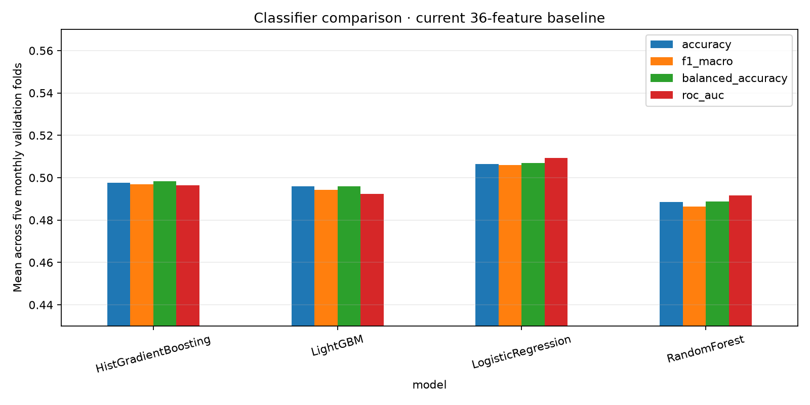
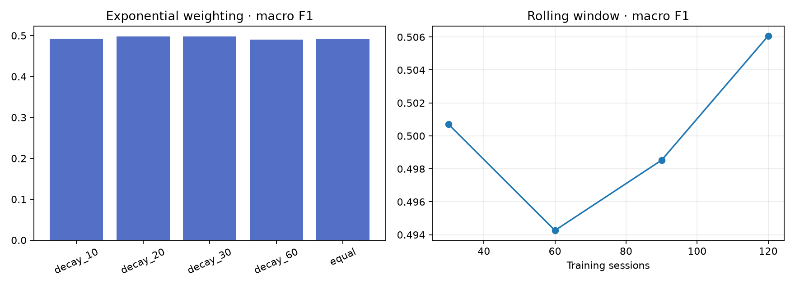
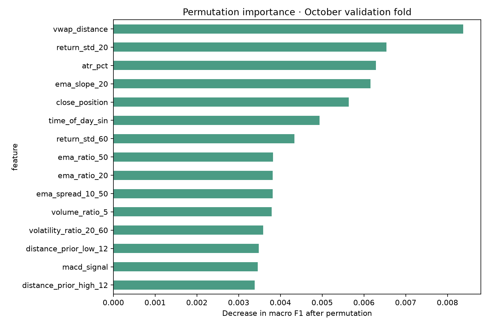

# AMZN 10-minute ML pipeline research report

Generated from local snapshot `AMZN_clean_20261110T010232.csv` (SHA-256 `cca838242e41d9515ac59e6fb7e249c5bff3189a5f0e3928b22c97913138d00a`). This is an offline research run. No live Alpaca calls were made. The challenger is saved separately; no production artifact is replaced.

## Existing pipeline audit

- Production 10-minute inference uses the frozen `artifacts/model_lightgbm.joblib` LightGBM classifier with 40 positional inputs in `artifacts/feature_columns.json`; the model stores generic `Column_0…Column_39`, so order is defined by that manifest and `src/features/legacy_engineering.py`.
- Other legacy artifacts were previously inventoried in `reports/experiments/legacy_model_audit.md`. The current 36-feature window-forecast pipeline is a separate model path. It must not be substituted for the 10-minute path.
- The legacy manifest used here has 40 inputs. The current feature pipeline contains 36 model inputs. The experimental expanded matrix contains 86 inputs. Diagnostic target columns and OHLCV are excluded from all feature matrices.
- Redundancy risks identified from the original schema include raw-price moving average/Bollinger level columns, `bb_middle`/`sma_20`, and `volume_ratio`/`volume_ratio_20`. These are correlated/redundant candidates, not assumed exact equivalents without checking computation.
- Historical audit reports weak, near-chance performance; the old result is not mixed into these walk-forward scores because it used a different test period and feature version.

### Exact original 40-feature order

`return_1, return_2, return_3, log_return_1, price_change, candle_body, candle_range, upper_wick, lower_wick, body_to_range, sma_5, sma_10, sma_20, ema_5, ema_10, ema_20, macd, macd_signal, macd_hist, rsi_14, roc_5, roc_10, atr_14, bb_upper, bb_middle, bb_lower, bb_width, bb_position, volume_change, volume_sma_5, volume_sma_20, volume_ratio_5, volume_ratio_20, volume_ratio, vwap_distance, hour, minute, day_of_week, time_of_day_sin, time_of_day_cos`

The frozen model accepts 40 inputs, has classes `[0, 1]`, and exposes `predict_proba`. The serialized artifact lacks reliable training-cutoff and preprocessing provenance; raw scores are therefore not described as calibrated confidence.

## Data and target

| Audit item | Result |
|---|---:|
| Source rows | 21,456 |
| Kept regular-session 5-minute candles | 21,420 |
| RTH rows removed (calendar/outside session) | 36 |
| Sessions | 276 |
| Date range | 2025-10-06T09:30:00-04:00 → 2026-11-09T15:55:00-05:00 |
| Duplicate / invalid OHLCV / off-grid | 0 / 0 / 0 |
| Missing / unexpected RTH bars after calendar filtering | 0 / 0 |
| Session lengths | `{'42': 3, '78': 273}` |
| Final test | 2026-11-02 → 2026-11-09, 6 sessions, 455 labeled examples |

The target is exact close-to-close return from the completed candle at *t* to the close of the exact candle timestamped *t+10 minutes*, same New York date and RTH. Positive return is UP, negative is DOWN; exact zero is unlabelled for the binary task. The 5-minute anchors overlap as labels; trading-return metrics select every second anchor to avoid double-counted positions. No synthetic 10-minute OHLC candle is constructed for model labels. Incomplete/missing exact exit candles are excluded.

## Validation and model comparison

Monthly expanding folds validate June–October 2026; training is strictly earlier than each validation month, the last two 5-minute training anchors are purged, and each fold’s median imputation/scaling is fit on its training subset. November 2–9 is the post-October final block and was not used for selection. The test contains only six sessions, so uncertainty is high. Model parameters are fixed and recorded; no random split or Optuna search was used. XGBoost/CatBoost were skipped when their packages were absent.

| model                | accuracy | precision_macro | recall_macro | f1_macro | balanced_accuracy | mcc     | roc_auc | pr_auc_up |
| -------------------- | -------- | --------------- | ------------ | -------- | ----------------- | ------- | ------- | --------- |
| HistGradientBoosting | 0.4975   | 0.4983          | 0.4984       | 0.4969   | 0.4984            | -0.0033 | 0.4963  | 0.4968    |
| LightGBM             | 0.4960   | 0.4959          | 0.4959       | 0.4944   | 0.4959            | -0.0081 | 0.4924  | 0.4964    |
| LogisticRegression   | 0.5064   | 0.5069          | 0.5069       | 0.5061   | 0.5069            | 0.0138  | 0.5094  | 0.5084    |
| RandomForest         | 0.4885   | 0.4886          | 0.4887       | 0.4865   | 0.4887            | -0.0227 | 0.4916  | 0.4938    |

The mean fold-specific train-majority baseline accuracy was **0.497**. Confusion matrices (fixed label order DOWN, UP), class-wise metrics, and per-fold baselines are retained in `model_comparison_folds.csv`.

Configuration ranking uses mean validation macro-F1, then balanced accuracy, then fewer features. The chosen validation configuration is **LightGBM / expanded / equal / 120 sessions**, with mean macro-F1 0.5061, balanced accuracy 0.5077, and ROC-AUC 0.5139. Logistic Regression’s validation macro-F1 is nearly tied; the tiny difference is not evidence that LightGBM is meaningfully superior.

### Recency strategies

| strategy | accuracy | f1_macro | balanced_accuracy | mcc     | roc_auc | trade_cumulative_gross_return | trade_max_drawdown |
| -------- | -------- | -------- | ----------------- | ------- | ------- | ----------------------------- | ------------------ |
| decay_10 | 0.4946   | 0.4925   | 0.4958            | -0.0083 | 0.5041  | -0.0192                       | -0.0801            |
| decay_20 | 0.4998   | 0.4976   | 0.5009            | 0.0021  | 0.5017  | 0.0021                        | -0.0672            |
| decay_30 | 0.4999   | 0.4982   | 0.5008            | 0.0017  | 0.5032  | 0.0184                        | -0.0620            |
| decay_60 | 0.4930   | 0.4907   | 0.4935            | -0.0129 | 0.4979  | 0.0483                        | -0.0460            |
| equal    | 0.4925   | 0.4915   | 0.4924            | -0.0153 | 0.4938  | 0.0310                        | -0.0567            |

| rolling_sessions | accuracy | f1_macro | balanced_accuracy | mcc     | roc_auc | trade_cumulative_gross_return | trade_max_drawdown |
| ---------------- | -------- | -------- | ----------------- | ------- | ------- | ----------------------------- | ------------------ |
| 30.0000          | 0.5037   | 0.5007   | 0.5055            | 0.0110  | 0.5084  | 0.0255                        | -0.0607            |
| 60.0000          | 0.4971   | 0.4943   | 0.4973            | -0.0052 | 0.4991  | -0.0040                       | -0.0632            |
| 90.0000          | 0.5005   | 0.4985   | 0.5011            | 0.0023  | 0.5026  | 0.0323                        | -0.0541            |
| 120.0000         | 0.5071   | 0.5061   | 0.5077            | 0.0154  | 0.5139  | 0.0518                        | -0.0508            |

Results are fold means, not a guarantee of future return. Neither exponential weighting nor shorter windows consistently dominate equal weighting; the selected 120-session LightGBM configuration was the validation winner by the declared macro-F1 rule.

## New feature groups and diagnostics

The research-only implementation adds normalized trend/slopes, RSI-7 and momentum changes, volatility ratios/regimes, volume context, candle proportions, prior-only market structure, session time encodings, and causal regime flags. Rolling swing highs/lows are shifted one candle. Session and calendar features use `America/New_York`; no future swing points or backward fill are used. Discrete nearest support/resistance zones were not added because no reproducible zone-merging rule was validated; shifted prior highs/lows are used as transparent market-structure proxies. Existing production feature code remains unchanged.

| feature_set | accuracy | f1_macro | balanced_accuracy | mcc     | roc_auc | trade_cumulative_gross_return |
| ----------- | -------- | -------- | ----------------- | ------- | ------- | ----------------------------- |
| current36   | 0.4960   | 0.4944   | 0.4959            | -0.0081 | 0.4924  | 0.0102                        |
| expanded    | 0.4925   | 0.4915   | 0.4924            | -0.0153 | 0.4938  | 0.0310                        |
| legacy40    | 0.4975   | 0.4927   | 0.4984            | -0.0032 | 0.4941  | 0.0189                        |

### Group ablation (LightGBM, mean across folds)

| ablation                    | removed_group       | f1_macro | balanced_accuracy | mcc     | trade_cumulative_gross_return |
| --------------------------- | ------------------- | -------- | ----------------- | ------- | ----------------------------- |
| current36_baseline          | all_advanced        | 0.4944   | 0.4959            | -0.0081 | 0.0102                        |
| without_advanced_candle     | advanced_candle     | 0.4982   | 0.4993            | -0.0013 | 0.0472                        |
| without_advanced_momentum   | advanced_momentum   | 0.4994   | 0.5006            | 0.0012  | 0.0172                        |
| without_advanced_regime     | advanced_regime     | 0.4915   | 0.4924            | -0.0151 | 0.0263                        |
| without_advanced_structure  | advanced_structure  | 0.4893   | 0.4898            | -0.0204 | -0.0112                       |
| without_advanced_time       | advanced_time       | 0.4902   | 0.4915            | -0.0170 | -0.0151                       |
| without_advanced_trend      | advanced_trend      | 0.4920   | 0.4933            | -0.0134 | 0.0126                        |
| without_advanced_volatility | advanced_volatility | 0.4937   | 0.4945            | -0.0110 | 0.0507                        |
| without_advanced_volume     | advanced_volume     | 0.4900   | 0.4909            | -0.0183 | 0.0413                        |

### Permutation importance

| feature                | permutation_macro_f1_mean | permutation_macro_f1_std |
| ---------------------- | ------------------------- | ------------------------ |
| vwap_distance          | 0.0084                    | 0.0022                   |
| return_std_20          | 0.0065                    | 0.0056                   |
| atr_pct                | 0.0063                    | 0.0039                   |
| ema_slope_20           | 0.0062                    | 0.0064                   |
| close_position         | 0.0056                    | 0.0004                   |
| time_of_day_sin        | 0.0049                    | 0.0010                   |
| return_std_60          | 0.0043                    | 0.0026                   |
| ema_ratio_50           | 0.0038                    | 0.0046                   |
| ema_ratio_20           | 0.0038                    | 0.0011                   |
| ema_spread_10_50       | 0.0038                    | 0.0029                   |
| volume_ratio_5         | 0.0038                    | 0.0060                   |
| volatility_ratio_20_60 | 0.0036                    | 0.0015                   |
| distance_prior_low_12  | 0.0035                    | 0.0049                   |
| macd_signal            | 0.0035                    | 0.0018                   |
| distance_prior_high_12 | 0.0034                    | 0.0024                   |

Importance is measured on the October validation fold only, not the final test. SHAP was unavailable in the environment and was not approximated. High correlation pairs (|Spearman| ≥ 0.95) are saved in `training_feature_correlations_ge_095.csv` for review.

### Regime analysis (October validation fold)

| dimension          | category | n         | accuracy | f1_macro | balanced_accuracy | mcc    | roc_auc |
| ------------------ | -------- | --------- | -------- | -------- | ----------------- | ------ | ------- |
| time_bucket        | opening  | 130.0000  | 0.5154   | 0.5070   | 0.5175            | 0.0365 | 0.5563  |
| time_bucket        | midday   | 1306.0000 | 0.5015   | 0.5007   | 0.5019            | 0.0038 | 0.5120  |
| time_bucket        | closing  | 218.0000  | 0.5505   | 0.5276   | 0.5359            | 0.0767 | 0.5209  |
| volatility_regime  | high     | 78.0000   | 0.5513   | 0.5506   | 0.5513            | 0.1029 | 0.5733  |
| volatility_regime  | low      | 1576.0000 | 0.5070   | 0.5043   | 0.5067            | 0.0136 | 0.5146  |
| trend_regime_label | trending | 1173.0000 | 0.5141   | 0.5114   | 0.5122            | 0.0246 | 0.5245  |
| trend_regime_label | sideways | 481.0000  | 0.4969   | 0.4948   | 0.5031            | 0.0064 | 0.5025  |

These subgroups are observational and some are small. The causal trend/volatility tags are exploratory, not a validated regime-aware trading policy.

### Optional 5 bps neutral target experiment

The separate 3-class experiment labels returns above +5 bps UP, below −5 bps DOWN, otherwise NEUTRAL; it does not change the binary target or selected model.

| fold    | validation_n | neutral_actual_share | macro_f1_3class | neutral_precision | neutral_recall | prediction_coverage |
| ------- | ------------ | -------------------- | --------------- | ----------------- | -------------- | ------------------- |
| 2026-06 | 1596.0000    | 0.1936               | 0.3557          | 0.2483            | 0.2395         | 0.8133              |
| 2026-07 | 1636.0000    | 0.2384               | 0.3581          | 0.3024            | 0.4436         | 0.6504              |
| 2026-08 | 1596.0000    | 0.2788               | 0.3439          | 0.3390            | 0.6225         | 0.4881              |
| 2026-09 | 1596.0000    | 0.2807               | 0.3325          | 0.3258            | 0.7411         | 0.3615              |
| 2026-10 | 1672.0000    | 0.2715               | 0.3735          | 0.3414            | 0.6564         | 0.4779              |

Neutral prediction coverage varies by fold and neutral F1 is modest. It is not enabled in production and its class probabilities are not calibrated.

## Final test and incumbent context

| model                                           | accuracy | macro_f1 | balanced_accuracy | roc_auc | gross_return |
| ----------------------------------------------- | -------- | -------- | ----------------- | ------- | ------------ |
| Selected challenger                             | 0.5429   | 0.5419   | 0.5433            | 0.5566  | 0.0116       |
| Frozen production LightGBM (provenance unknown) | 0.5385   | 0.5294   | 0.5301            | 0.5124  | 0.0231       |

Selected challenger final test: 0.543 accuracy, 0.542 macro-F1, 0.543 balanced accuracy, 0.557 ROC-AUC. Majority baseline (training majority UP) is 0.453. For every-second 10-minute entry, hypothetical gross return is 1.16%, maximum drawdown -5.97%, and profit factor 1.051; these omit commissions, spread, slippage, and execution constraints.

The frozen incumbent’s same-period score is **context only**: its serialized artifact does not contain an auditable training cutoff, so strict no-overlap provenance cannot be certified. No production artifact was altered. Challenger raw scores and Brier/log-loss are reported as uncalibrated; calibration was not performed.

## Retraining and drift design

`src/experiments/retraining.py` provides research helpers: daily/weekly/monthly cadence checks; maturity filtering that only admits a sample after its t+10 exit candle has completed (t+15 from the input candle start); reference-binned PSI drift monitoring (default alert threshold 0.20); and explicit manual-review champion/challenger gates (minimum sample size, macro-F1 gain, balanced accuracy, drawdown, fold-level F1 stability). A passing challenger is never auto-promoted.

| Policy | Cadence / trigger | Benefits | Risks and intended use |
|---|---|---|---|
| Daily | Retrain after each completed session, using only matured labels | Reacts fastest to changes | Highest operational and selection variance; evaluate as a challenger only |
| Weekly | Retrain once per week from matured data | Lower compute and less day-to-day noise | Can lag abrupt drift; practical initial candidate cadence |
| Periodic + drift | Monthly review, or request a candidate run when any monitored PSI ≥ 0.20 | Stable baseline plus explicit drift signal | PSI can false-alarm and needs enough recent observations; drift does not itself justify promotion |

These policies are specified and their cadence, label maturity, PSI and promotion guardrails are unit-tested; this dataset run did not replay all three scheduling policies as separate forecasting backtests. Daily/weekly/periodic live retraining is not scheduled or exercised here.

## Reproducibility and artifacts

- Run: `python scripts/run_ml_experiments.py`
- Render this report and charts: `python scripts/render_ml_experiment_report.py`
- Dataset hash and run parameters: `data_and_target_audit.json`, `experiment_config.json`.
- Fold metrics: `model_comparison_folds.csv`, `feature_set_comparison_folds.csv`, `time_decay_folds.csv`, `rolling_window_folds.csv`, `feature_ablation_folds.csv`, `neutral_5bps_experiment_folds.csv`.
- Challenger model: `artifacts\experiments\amzn_ml_upgrade_v1_challenger.joblib`; metadata, feature order, parameters and data hash are in `selected_challenger_metadata.json`.
- No frontend, backend, scheduler, or production model files are changed by this experiment code.

## Conclusion and limitations

The new experimental pipeline is reproducible and offers better diagnostics; predictive improvement is **not established robustly**. On the six-session final block the selected challenger modestly exceeds the observed majority accuracy, but the edge is small (MCC 0.086, ROC-AUC 0.557) and gross-return results are before costs. Five-fold validation averages remain close to chance. Continue collecting future data and require a separately frozen, provenance-tracked champion/challenger period before considering deployment. No model promotion is recommended from this short sample.
